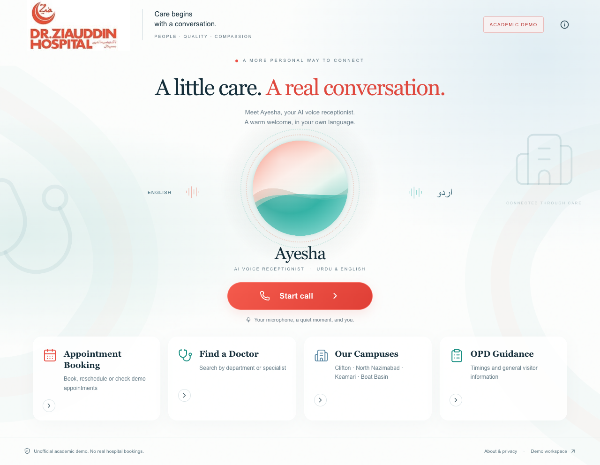

# Ayesha

A bilingual AI voice receptionist for an **unofficial Dr. Ziauddin Hospital academic demonstration**. Built with Next.js, React, TypeScript, Tailwind, native WebRTC, direct OpenAI GPT-Live, and PostgreSQL. It never connects to the hospital's booking systems.



## Documentation for your presentation

Start with the [complete documentation index](docs/README.md) and [presentation script and viva answers](docs/PRESENTATION-AND-VIVA.md). Detailed guides cover [architecture](docs/ARCHITECTURE.md), [every source module and API route](docs/SOURCE-CODE-GUIDE.md), [models and prompts](docs/MODELS-AND-CONVERSATION.md), [database and safeguards](docs/DATABASE-AND-SAFEGUARDS.md), and [configuration and operations](docs/SETUP-AND-OPERATIONS.md).

The current public frontend uses the supplied hospital logo, light hospital-themed styling, red primary actions, a coral-and-teal audio orb and four service cards. Ayesha's revised personality supports sustained everyday conversation, witty teasing and innocent flirting while retaining AI transparency and sensitive-care tone changes. These prompt changes still require live behavioral evaluation.


## Run on a MacBook

Use Node.js 22.6+ and Chrome. This workspace was tested using Node 25 and Chrome on macOS.

```sh
npm ci
npm run setup
npm run dev
```

Open **http://localhost:3000**. The setup command creates `.env.local` with a random administrator password and session signing secret; it never overwrites an existing file. Find `ADMIN_PASSWORD` in that file to sign in at **http://localhost:3000/admin**. No API key or password is shown in browser code.

The administrator workspace and booking operations work without OpenAI credentials. The default local mode uses persistent **PGlite, a real embedded PostgreSQL engine**, in `.data/postgres`. This is an explicit development alternative to Supabase, not a fake booking service. It seeds four campuses, 54 specialties, 162 fictional doctors (three per specialty), two synthetic patients and fourteen days of half-hour slots. The administrator can make, cancel and reschedule bookings, add or block slots, filter records and reset synthetic data. Do not run two app processes against the same local database directory.

### Enable voice

Open `.env.local` locally and fill in `OPENAI_API_KEY`. Use a project with `gpt-live-1` access and API billing. Restart the app. Do not paste the key into chat or any browser field.

Click **Start call**, read the consent notice, then **Agree & start call**. Allow microphone access. The browser sends its SDP offer to our trusted server; the server posts it to `https://api.openai.com/v1/live/sessions` and returns the SDP answer. The API key remains on the server. Microphone and speaker audio travel continuously over WebRTC, with echo cancellation and noise suppression requested.

Ayesha waits for `session.started`, then receives a greeting instruction. Captions use the documented `session.input_transcript.delta` and `session.output_transcript.delta` events. Client delegation preserves the original delegation ID when returning `session.commentary.append` results. There is **no STT → text → TTS pipeline and no alternative voice model fallback**.

The voice is provisionally `gleam`, a documented feminine voice. It has **not been benchmarked for Pakistani Urdu**. You can set `LIVE_VOICE` or an existing authorized `LIVE_CUSTOM_VOICE_ID`. See [voice evaluation](docs/VOICE-EVALUATION.md).

### Use Supabase PostgreSQL

1. Choose a **dedicated demo project**. Never use a database containing real patient records.
2. Get its PostgreSQL connection URI from Supabase's Connect panel. A session-pooler URI is useful on IPv4-only networks. Keep TLS verification enabled; use the project CA if your network requires it.
3. Set `DATABASE_MODE=supabase` and `DATABASE_URL` in `.env.local`.
4. Stop the application, then run `npm run db:setup` and restart.

`db:setup` applies the idempotent schema and seeds **synthetic** records. It makes no OpenAI requests. Alternatively, apply `supabase/migrations/20261021071217_ayesha_demo.sql` through your migration workflow, then run the seed setup. The migration was created with the Supabase CLI. This project uses a server-side PostgreSQL connection (`pg`), not a browser service-role key. Tables have RLS enabled and no public row policies; `anon`/`authenticated` access and public function execution are revoked. Use the database owner connection for this academic demo.

**A hosted Supabase project has not been configured or tested in this workspace.** The same schema, PL/pgSQL transactions and repository operations have been exercised against local PostgreSQL through PGlite. The concurrency test checks competing promises and the unique constraint; PGlite serializes access. Verify cross-connection concurrency on your Supabase instance before presenting it as hosted-database validated.

## Voice appointment confirmation

The caller can complete booking entirely by voice. After reading the proposal, Ayesha asks whether to go ahead. Natural Urdu, Roman Urdu, English and mixed replies are interpreted against that exact pending proposal. Brief “okay” or “yes” is sufficient only in a clear response to a final-approval question. Refusals do not book; changed details require a fresh proposal and approval. The on-screen proposal is informational and has no confirmation button.

The browser proactively checks new speech while a proposal is pending, even if no further Live delegation event arrives. Server revision, expiry, identity and availability checks still control the transaction. A durable attempt and stable `session:proposal` operation key prevent repeated approval from creating duplicate records. If an HTTP response is lost, `/api/booking-status` reconciles the original SQL result before any new attempt. Unknown is not reported as failure or success.

See [booking reliability repair](docs/BOOKING-RELIABILITY.md) for root causes, state transitions, timeout values and acceptance evidence. Language interpretation remains probabilistic; use synthetic data and evaluate ambiguous speech and interruptions before making production claims.

## Budget and privacy

Default calls last ten minutes. Voice pricing is configured at $0.05/minute, based on the official documentation checked on 2026-10-21. Initialization can incur 15 seconds of voice usage, credited toward running duration. Backend model usage is separate. Set the input/output token prices for your backend model in `.env.local`; otherwise backend dollars remain **unpriced**, not free.

The app records cumulative voice seconds, backend token counts and estimated cost. It reserves a full call's voice allowance when checking new calls, limits backend delegations, and shows a warning near the end. A local server-side sideband watchdog requests closure at the configured duration; the browser independently closes the session. `session.closed` confirms finalization, while failure or timeout leaves it unconfirmed. Background browser throttling, process termination and serverless suspension can defeat local timers. **This is not authoritative billing or a guaranteed $20 cap.** Configure project spending controls or alerts where available and check your [OpenAI usage dashboard](https://platform.openai.com/usage). Don't assume an alert is a hard stop.

No audio is recorded by this application; session storage is disabled. Audio and necessary text context are sent to OpenAI for inference. Provider processing is subject to your API data controls. Application transcript arrays are cleared on call end; abandoned-session fragments may remain until a later cleanup/start. Derived result objects, delegation job results, synthetic appointments and aggregate usage can persist. This is not a comprehensive deletion policy; see the database and safeguards guide. Only use made-up names and phone numbers. No CNIC, medical history, diagnoses or prescriptions.

## Verification

```sh
npm test                 # Offline PostgreSQL / workflow tests, no paid requests
npm run typecheck
npm run build
npm run test:e2e          # Uses installed Chrome, isolated .data/e2e-postgres, no API key
```

Browser tests use Chrome by default. To use Playwright's bundled browser, install it with `npx playwright install chromium` and set `PLAYWRIGHT_CHANNEL=chromium`. Tests intercept the voice transport where necessary; **a mocked protocol test is not a real audio-quality test**. Do not run the development server on port 3100 during the E2E suite. See [test results and gaps](docs/VALIDATION.md) and [demonstration scenarios](docs/DEMO-SCENARIOS.md).

## What is real, mocked, or pending

| Component | Status |
| --- | --- |
| Call interface, consent, responsive layouts and admin login | Implemented; Chrome browser tests passed |
| Doctor search, availability, create/cancel/reschedule | Actual PostgreSQL operations; offline integration tests and browser lifecycle passed |
| Unique reservations, idempotency, stale confirmations, identity checks | Tested on PGlite; hosted concurrency validation pending |
| Public hospital knowledge | Source-dated official-site facts, with known inconsistent FAQs excluded |
| GPT-Live WebRTC and client delegation | Three consecutive real synthetic-audio bookings verified persisted records and post-commit output captions/audio; see the reliability report |
| Spoken Urdu and conversational quality | User tested speech and reported weak Urdu accent; pronunciation/personality prompts revised; systematic native-speaker listening evaluation pending |
| Feminine voice benchmarking and custom voice | Configurable; listening evaluation pending; no custom voice generated |
| Supabase hosting, Safari/iOS and Vercel deployment | Setup provided; not validated here |

## Deployment and troubleshooting

See [architecture and deployment](docs/ARCHITECTURE.md) and [troubleshooting](docs/TROUBLESHOOTING.md). Local Chrome is the primary presentation environment. Remote deployments require Supabase, HTTPS, a persistent `SESSION_SECRET`, an `ADMIN_PASSWORD` and exact `APP_ORIGIN`. Paid session creation requires administrator authentication for non-local origins. In-memory sideband watchdogs are disabled on Vercel; run a persistent Node service if you need server-enforced session termination. Do not expose a local development server publicly.

Hospital facts and API contracts are documented in [sources](docs/SOURCES.md). This application is an academic simulation, not production healthcare software.
