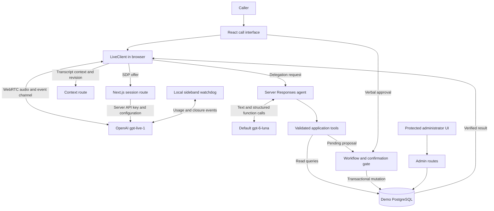
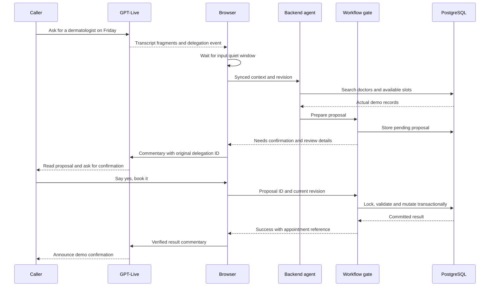

# Ayesha architecture — technical explanation

> Updated 2026-10-23: See [the voice reliability repair](BOOKING-RELIABILITY.md) for natural approval, bounded waits and reconciliation evidence.
[Documentation index](README.md) · [Source walkthrough](SOURCE-CODE-GUIDE.md) · [Models](MODELS-AND-CONVERSATION.md)

This document describes the implementation inspected on 2026-10-22. Ayesha is an unofficial academic simulation. PostgreSQL transactions are real; its doctors, patients and appointments are synthetic. It does not integrate with hospital patient systems.

## 1. Architectural idea

The system separates conversation, reasoning and authority:

1. **Conversation:** a browser exchanges live audio with OpenAI `gpt-live-1`.
2. **Task reasoning:** a server-side Responses agent, defaulting to `gpt-6-luna`, selects constrained functions to retrieve facts or prepare a proposal.
3. **Authority:** TypeScript validation and PostgreSQL enforce confirmation, identity matching, availability and atomic writes.

An AI sentence saying “booked” is not a database commit. The application must receive a verified operation result. This separation makes conversational flexibility compatible with deterministic record handling.

## 2. Component diagram

The API key and database connection stay on the server. The browser receives SDP and application results, not credentials. Audio normally travels between the browser and OpenAI, rather than through a custom application audio relay.

## 3. Technology choices

| Technology | Role in this repository | Why it fits |
| --- | --- | --- |
| Next.js App Router | Pages, React rendering and HTTP route handlers | One project contains the interface and trusted backend |
| React | Consent, call controls, transcript, proposals, admin forms | UI state follows asynchronous audio and task events |
| TypeScript | Shared interfaces and developer checks | Makes event, proposal and database result shapes explicit |
| CSS / Tailwind toolchain | Responsive hospital-themed presentation | Most visual rules are custom CSS in `globals.css` |
| Canvas and Web Audio | Animated orb and measured audio levels | The orb responds to sound without another AI model |
| WebRTC | Continuous bidirectional browser audio | Native microphone/speaker transport and data channel |
| OpenAI Live and Responses APIs | Conversation and backend tool selection | Separate fast voice behavior from structured task work |
| Zod | Runtime request and tool-argument validation | TypeScript types alone do not validate incoming JSON |
| PostgreSQL / PGlite / pg | Constraints, records, transactions and adapters | The same repository interface supports local and hosted modes |
| Vitest / Playwright | Database/workflow tests and browser flows | Tests both business rules and interaction behavior |

Exact installed versions are in `package.json` and `package-lock.json`; those files are the version authority. Avoid describing the application as a Python, Flask, LangChain, separate speech-recognition or standalone text-to-speech project: those are not its implementation.

## 4. Starting a call, step by step

1. The page loads public configuration from `GET /api/bootstrap`. `configured: true` only means a key is present, not that billing or model access is valid.
2. The caller opens the consent dialog and accepts. The browser requests microphone permission with echo cancellation, noise suppression and automatic gain control preferences.
3. `POST /api/bootstrap` creates a database session and a signed, HttpOnly cookie. Expired session transcript arrays and proposals are cleaned opportunistically here.
4. `LiveClient` creates `RTCPeerConnection`, adds the microphone track and opens a data channel named `oai-events`.
5. It generates an SDP offer. SDP is connection-negotiation text, not the recording of a conversation. ICE gathers possible network connection candidates.
6. The browser posts the offer to `/api/session`. The route checks origin, cookie, rate limit and local experiment allowance, then claims this application session so duplicate creation is rejected.
7. The server creates a Live session using `gpt-live-1`, the configured voice, `VOICE_PROMPT`, `GREETING`, `store: false` and client delegation.
8. The returned SDP answer is applied to the peer connection. Remote audio is attached to an HTML audio element.
9. `session.started` marks model readiness. The client sends its greeting commentary once for that readiness event, starts timers and samples audio levels.

The greeting is also included in the initial developer input. Both paths are visible in the code; the protocol test verifies one client append, not that audible speech can never repeat. Actual startup delivery remains a listening-test concern.

## 5. A booking sequence

Voice confirmation follows a related path: the caller's new transcript must match an operation-specific phrase, then the backend invokes the deterministic confirmation gate before calling the reasoning model. General agreement, teasing and compliments do not authorize a booking.

## 6. Timing, fragments and stale work

Transcripts arrive as fragments, each with text, role, event ID and timestamps. They are not guaranteed completed user turns. The browser deduplicates event IDs, keeps at most 500 fragments and increments a revision number for each user fragment. Assistant output does not increment the revision.

Context synchronization is debounced by 250 ms. Delegation normally waits until 1,200 ms after the last received user fragment. That delay reduces work on partial corrections; it is not an infallible speech-end detector. The latest utterance helper joins nearby user fragments when their timestamp gap is less than 1,800 ms.

Example: a caller asks for Thursday, then changes to Friday while a lookup runs. The later speech increases the revision. Server checks and client result handling prevent an old proposal from being presented as the current request. A confirmed transaction remains a confirmed transaction; a later correction needs a new operation.

There are two IDs to distinguish:

- The original Live delegation ID associates returned commentary with the model's request.
- The application job key combines that ID and the revision to deduplicate a particular backend attempt.

The browser coordinates delegation. The sideband watchdog does not run an independent reasoning agent.

## 7. Two independent state machines

**Call state:** idle, connecting, connected, listening, speaking, processing, recovering, ending, ended or error. The “speaking” indicator is an audio-level heuristic, not a perfect semantic detector. UI mute and speaker controls change media behavior.

**Appointment state:** no proposal, pending proposal, confirmed mutation or error/stale result. Appointment records themselves have `confirmed` or `cancelled` status; rescheduling changes the slot on the existing record.

Ending a call does not cancel an appointment. Interrupting speech does not cancel an appointment. A UI animation does not prove that a database action happened.

## 8. Ending and recovering

On End call, the microphone tracks stop immediately. If the Live session is running, the client sends `session.close` and waits up to five seconds for `session.closed`. It then releases peer connection, channel, audio element, AudioContext and timers, and posts usage/finalization to `/api/end`.

The endpoint clears the transcript array and pending proposal and returns the latest completed appointment result where available. Keeping `last_appointment_result` separate from `last_result` prevents later small talk from erasing the final booking summary.

A disconnected peer gets an eight-second recovery window. Failed connections require a new caller-initiated call; the app does not automatically create repeated paid sessions. A local WebSocket sideband observes usage and can request closure at the configured duration. It is best effort: process failure or socket failure can remove that protection.

## 9. Deployment boundaries

The supported presentation setup is a local Node process and Chrome, with persistent PGlite storage. One process should own a given local database path. Tests use their own database path.

Hosted mode uses `DATABASE_MODE=supabase` and a server-side PostgreSQL connection with certificate verification enabled. The pool has a maximum of five connections. The application does not use Supabase browser authentication, Storage or Realtime.

Vercel is an optional, unvalidated deployment path. Local database mode is explicitly rejected there. The in-memory watchdog is disabled because serverless execution cannot be assumed to persist after the HTTP response. A persistent service or durable control process would be needed for stronger server-side duration enforcement. Non-local paid session creation requires administrator authentication.

## 10. What is deliberately not implemented

No hospital integration, clinical diagnosis, prescription generation, phone-network dial-in, WhatsApp messaging, OTP patient login, vector database, model fine-tuning or persistent personalized conversational memory is implemented. The current browser call is not a PSTN phone call. These are possible future projects, not features to claim in the presentation.
