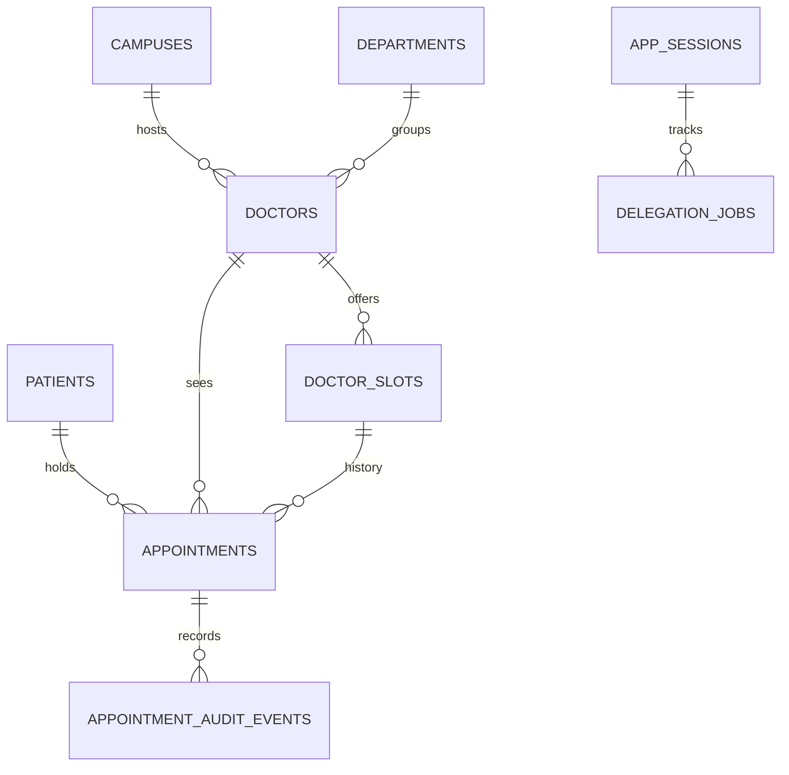

# Database design, confirmation and safeguards

> Updated 2026-10-23: See [the voice reliability repair](BOOKING-RELIABILITY.md) for natural approval, bounded waits and reconciliation evidence.
[Documentation index](README.md) · [Architecture](ARCHITECTURE.md)

## Local and hosted storage

The default uses PGlite, an embedded PostgreSQL engine stored under `.data/postgres`. It runs SQL, constraints and PL/pgSQL rather than simulating successful bookings in memory. Unit tests use independent in-memory instances; browser tests use an isolated disk directory.

The optional hosted adapter uses `pg` and `DATABASE_URL` for Supabase PostgreSQL. The workflow sees the same `DB` interface in either mode. Hosted operation, independent-connection races and deployment permissions have not been validated in this workspace. PGlite serializes operations, so its competing-promise tests cannot establish every property of a hosted concurrent system.

## Entity relationships



A slot may have multiple historical cancelled appointments but at most one confirmed appointment. A new booking creates a synthetic patient row; this is not a deduplicated longitudinal patient registry.

## Table catalogue

| Table | Key / important data | Purpose |
| --- | --- | --- |
| `campuses` | Text ID, name, address, contact, active | Locations used by the demonstration |
| `departments` | Text ID, unique name, description | Specialty grouping |
| `doctors` | Text ID, department/campus foreign keys, fee, active, demo flag | Fictional directory |
| `doctor_slots` | UUID, doctor, start/end timestamps, available/blocked | Schedule intervals |
| `patients` | UUID, synthetic name, normalized phone, creation time | Contact identity for demo bookings |
| `appointments` | UUID, unique `AY-` reference, patient/doctor/slot IDs, status | Current booking state |
| `appointment_operations` | Idempotency key, input fingerprint, result | Makes repeated requests return the same committed outcome |
| `appointment_audit_events` | UUID, appointment, action, time | Minimal operation history; not a comprehensive clinical audit log |
| `app_sessions` | UUID, revision, fragments, pending, last results, Live ID, usage and expiry | Application conversation state and accounting |
| `delegation_jobs` | Composite session/job key, revision, result | Deduplicates backend attempts |
| `rate_limits` | Bucket, time window, count | Persistent request counters |
| `hospital_knowledge_sources` | Topic, content, source URL, verification date | Seeded fact display for administrators |

Times use PostgreSQL `timestamptz`. Availability filters interpret dates in `Asia/Karachi`; UI summaries format Pakistan time. “Kal” and “parson” are ambiguous without tense/context, so the backend is instructed to clarify the exact date.

## Proposal versus commit

A proposal stores a UUID, action, validated arguments, readable summary, creation timestamp and revision. It does not reserve a slot. This means another caller could reserve the slot before confirmation; the mutation must recheck availability.

The confirmation gate locks the session row. It checks the session is open, proposal identity matches, revisions are valid and the proposal is no more than 120 seconds old. The voice approval must refer to the unchanged proposal revision. A semantic interpreter checks natural approval against the current proposal and subsequent transcript; brief acknowledgements require an actual final-approval question.

Examples include “Confirm kar dein”, “Yes, book it” and Urdu-script equivalents. A short “yes” or “okay” can authorize only in clear response to the final-approval question. Changes to details require a fresh proposal. Ambiguous or conditional approval is clarified. Semantic interpretation is probabilistic and still needs representative live evaluation.

The key for a voice-flow mutation is `session ID : proposal ID`. If an HTTP reply is lost after the database commits, a retry can return the stored result instead of creating a duplicate. A successful mutation updates both `last_result` and `last_appointment_result`.

## SQL enforcement

`mutate_appointment` is the central PL/pgSQL mutation function:

1. Validate the operation and idempotency key.
2. Acquire an advisory transaction lock derived from the key.
3. If the key already exists, require the same action/arguments fingerprint and return its prior result.
4. For cancellation/rescheduling, locate the record using reference and phone, lock it and require confirmed status.
5. For creation/rescheduling, lock the target slot and verify future time, available status, active doctor/campus and no conflicting confirmed appointment.
6. Insert the synthetic patient and appointment, cancel the existing appointment, or move it to the new slot.
7. Construct the result, persist the idempotency record and add an audit event.

Exceptions roll back the transaction. A failed reschedule must leave the original booking intact. Cancellation changes appointment status; it need not set a separate “free” flag on the slot because availability is calculated by the absence of a confirmed reservation.

The partial unique index is the final reservation invariant:

```sql
create unique index if not exists one_active_booking_per_slot
on appointments(slot_id) where status='confirmed';
```

This remains important even if two requests both previously saw the slot as available. An application lookup alone cannot guarantee exclusive booking.

The overlap trigger locks the doctor row and rejects schedule intervals when `existing.start < new.end AND existing.end > new.start`. Adjacent slots are allowed. This prevents an administrator from creating overlapping intervals for one doctor. Hosted concurrency should still be tested before claiming production proof.

## Security controls and their limits

| Control | What it helps with | What it does not establish |
| --- | --- | --- |
| Server-only API key usage | Keeps provider credential out of browser requests | Unlimited provider account safety |
| HMAC-signed HttpOnly cookies | Detects token tampering and limits script access to cookies | Full patient authentication or cookie encryption |
| SameSite Strict and exact origin checks | Reduces unwanted cross-site mutations | Complete protection against a same-origin compromise |
| Admin password and signed expiry token | Protects demonstration operator endpoints | MFA, named staff accounts or production identity governance |
| Zod validation and bounded bodies | Rejects malformed/oversized payloads | Truthfulness of user-supplied data |
| Parameterized SQL | Separates values from SQL command structure | Correct business logic by itself |
| Revision, expiry and confirmation checks | Reduces stale or unintended operations | Perfect interpretation of interrupted speech |
| Unique constraints and transaction locks | Protects booking consistency | Fully tested multi-region deployment |
| Rate limits and bounded agent work | Limits repeated requests | Guaranteed prevention of abuse or cost overruns |

RLS is enabled and access is revoked from `anon` and `authenticated` when those roles exist. Public execution of sensitive functions is revoked. The trusted server uses the database owner connection in this demo; table owners ordinarily bypass RLS. Therefore do not say RLS restricts what a compromised owner-connected server can do. Least-privilege roles and a fuller security review are future production work.

Browser-supplied transcripts are not a trusted identity channel. The current app is designed for synthetic data and controlled local use. A reference plus phone match is a basic demonstration check, not OTP verification.

## Privacy and retention

The application does not save audio recordings, and Live/Responses requests use `store: false`. Audio and relevant text still go to OpenAI for processing. That flag does not mean data never leaves the device or establish a universal provider-retention promise.

On normal call end, the application's `fragments` array and pending proposal are cleared. The sideband also clears these on observed closure. Expired sessions receive opportunistic cleanup on a later bootstrap.

However, result objects, delegation job results, operation fingerprints, synthetic booking rows and usage records can persist. These may contain task-related text or synthetic contact details. This implementation does not implement a complete retention/deletion policy for every derived field. Abandoned sessions can keep fragments until cleanup. Present this accurately and only use invented patient data.

## Failure examples for the teacher

- **Two bookings choose one slot:** the database permits at most one confirmed reservation.
- **Network drops after commit:** inspect the admin record or retry with the same operation key; never assume a timeout means no write happened.
- **Caller corrects Thursday to Friday:** revision checks invalidate stale proposals; a previously committed booking needs a new reschedule.
- **Wrong phone with a valid reference:** lookup/change is rejected for the caller path.
- **Backend model fails:** UI shows an error rather than a fabricated successful appointment.
- **Watchdog process dies:** independent cost enforcement is not guaranteed; provider usage remains the billing authority.
